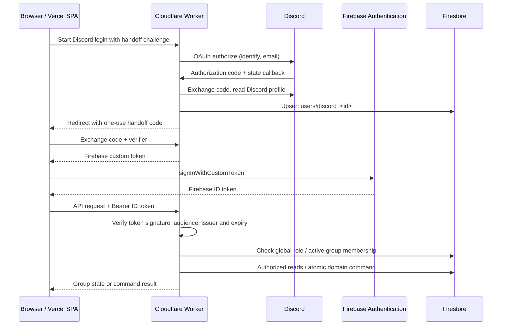
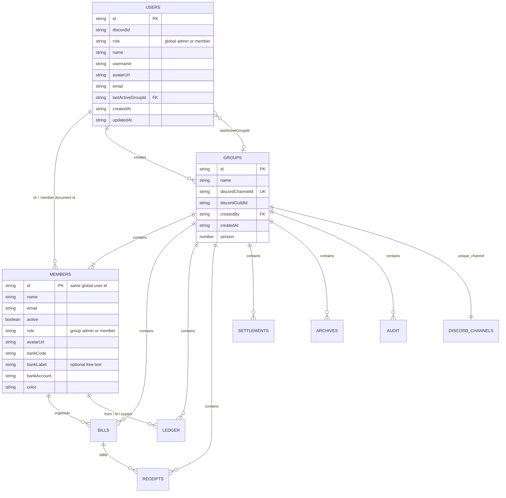

# Authentication, groups and service setup

The repository contains both the SvelteKit frontend and Cloudflare Worker backend. Vercel hosts the frontend, Firebase provides Authentication and Firestore, and Cloudflare runs OAuth, authorization, financial commands and Discord REST integrations. Deployment has not been performed. There is no data migration because this app has not been published.

## Request and login flow



Firebase custom authentication lets the Worker use Discord as the identity provider while keeping Firebase sessions. The browser sends Firebase **ID tokens**, not custom tokens, to protected APIs. See [Firebase custom authentication](https://firebase.google.com/docs/auth/admin/create-custom-tokens) and [ID-token verification](https://firebase.google.com/docs/auth/admin/verify-id-tokens).

The provider OAuth flow uses a confidential client, fixed callback, random state, HttpOnly state cookie and single-use server state. A separate challenge/verifier protects the browser handoff: its code expires after 60 seconds, is consumed once, and is removed from the URL before exchange. OAuth state expires after ten minutes. Custom tokens expire after five minutes. Names, avatars and optional email are profile data; only the Discord snowflake determines identity. The Firebase UID and document ID are both `discord_<snowflake>`.

Production accepts only signed Firebase ID tokens for the configured project. Local mode validates against the Auth emulator and is restricted to loopback hosts and the demo project. Password login, anonymous login, and the previous demo-session API are absent.

## Data model



| Path                                | Purpose / remaining fields                                                                                                                                                   |
| ----------------------------------- | ---------------------------------------------------------------------------------------------------------------------------------------------------------------------------- |
| `users/{discord_userId}`            | Global identity/profile/role and last selected group, as above                                                                                                               |
| `groups/{groupId}`                  | Channel association and financial version, as above                                                                                                                          |
| `discordChannels/{channelId}`       | `channelId`, `groupId`; transactional uniqueness index                                                                                                                       |
| `groups/{groupId}/members/{userId}` | Group profile, role, activation and bank details                                                                                                                             |
| `groups/{groupId}/bills/{id}`       | `id`, `organizer`, `description`, `date`, `createdAt`, `lines[]`, `total`, `emailReceipt`, optional `memberNames`; each line has `memberId`, `amount`, `description`, `note` |
| `groups/{groupId}/ledger/{id}`      | `id`, `from`, `to`, `type`, `amount`, `date`, `createdAt`, `description`, `note`, `creator`, `source`, `reference`, optional `legacySequence`                                |
| `groups/{groupId}/receipts/{id}`    | `id`, `billId`, `status`, `recipients[]`, `attempts`, `error`, `createdAt`; simulated email delivery                                                                         |
| `groups/{groupId}/settlements/{id}` | `id`, `hub`, `date`, `creator`, `version`, `entryCount`                                                                                                                      |
| `groups/{groupId}/archives/{id}`    | `id`, `name`, `url`, `date`                                                                                                                                                  |
| `groups/{groupId}/audit/{id}`       | `id`, `actor`, `action`, `date`, `reference`                                                                                                                                 |

The group is represented by the Firestore path, not a redundant `groupId` field in each child record. Member IDs repeat across groups, while bank details and display names can differ per group. Amounts are integer VND; dates are ISO strings. `bankCode` resolves a bank BIN for QR generation and `color` is an internal avatar fallback; neither has a dedicated configuration control. Removed fields such as `bankName` and department are absent.

Cloudflare Durable Object storage holds short-lived OAuth states, one-use handoffs, DM deduplication IDs and rate-limit slots. These are backend internals rather than Firestore business collections. The Wrangler `migrations` declaration creates the Durable Object SQLite class; it is platform resource provisioning, not a migration of app data.

## Roles and membership

- A **global admin** may list the bot's channels, inspect their members and create a group. A global admin does not bypass inactive group membership.
- A **group admin** must be active. They manage activation/roles/profiles, sync members, send group DMs, import history and simplify debt. Group admin status does not grant group-creation privileges.
- An **active group member** may access the group's state, create bills, confirm their own QR payments and update their own group profile. The backend determines the actor from the token.
- Imported members always start inactive with group role `member`. The creator is the bootstrap exception: active group admin, allowing them to activate everyone else. Self-deactivation/demotion is blocked by the current management command.
- Inactive members cannot read or mutate group state, even if their financial records remain for history. The last selected group is persisted in the global user document. Login falls back to another active group if access to the remembered group was removed.

`DISCORD_ADMIN_IDS` bootstraps specific numeric Discord IDs into global admin status on login/import. Other new users default to `member`. Existing global roles are preserved, so removing an ID from the allowlist does not itself demote an existing admin: also change that user's global `role` in trusted Firestore administration. There is no client API for editing global roles.

## Local development

```powershell
npm ci
npm run dev
```

Prerequisites: Node.js 24 LTS and Java 21+. The local launcher runs Firebase emulators for `demo-lunchroom`, seeds a fresh Discord-based fixture when needed, starts Wrangler on `127.0.0.1:8787`, and starts Vite on `127.0.0.1:5173`. The first Firebase run may download emulator binaries. Use the login button and pick one of the mock Discord accounts.

The seeded Minh An (`discord_100000000000000001`) is the global admin and local group's active admin. The other users are inactive. Activate Thảo Linh or Quang Huy in member management before testing their group access. A second mock channel is available for testing group creation. No real OAuth, Discord API calls or DMs occur in local mode, even if credentials exist in the shell.

Local configuration is committed under `env.local` in `wrangler.jsonc`. `.env.example` contains the frontend's `VITE_WORKER_API_URL`; Vite defaults to the local Worker URL during development. Local database/auth hosts cannot point at production. Emulator snapshots and Wrangler storage are ignored by Git.

Separate processes, if desired:

```powershell
npm run emulators
# In another terminal, after emulator startup:
npm run seed:local
npm run dev:worker
# In a third terminal:
npm run dev:web
```

## Connect Discord

1. Create an application in the [Discord Developer Portal](https://discord.com/developers/applications). Record its application/client ID and generate an OAuth client secret.
2. Create/configure its bot and obtain a bot token. Under Bot → Privileged Gateway Intents, enable **Server Members Intent** (`GUILD_MEMBERS`); approval may be required for eligible verified apps. Listing guild members requires this intent even though this app uses REST rather than a persistent Gateway connection. See [List Guild Members](https://docs.discord.com/developers/resources/guild#list-guild-members).
3. Install the bot into the intended server with the `bot` scope. Grant View Channels for the target text channels and permission to send the requested messages. No Administrator or Message Content intent is required by this implementation. Recipient privacy settings may still prevent DMs.
4. Under OAuth2, add exactly `https://YOUR-WORKER-HOST/auth/callback` as a redirect URI. The Worker requests user scopes `identify email`; it never uses email as identity. See [Discord OAuth2](https://docs.discord.com/developers/topics/oauth2).
5. Enable Discord Developer Mode and copy the intended administrators' numeric user IDs. Set them in `DISCORD_ADMIN_IDS` as a comma-separated list. Optionally restrict server discovery with comma-separated `DISCORD_GUILD_IDS`.

“Members of a channel” means non-bot guild members who can view it, after applying owner/admin, everyone-role, combined role and member-specific overwrites. Bot-visible channels are checked with the bot's own permissions. Text and announcement channels are supported; voice presence and thread membership are different features and are not included. See [Discord permissions](https://docs.discord.com/developers/topics/permissions).

Synchronization adds missing users and inactive memberships. Existing names/bank details, activation and group roles are retained. Users who leave Discord are retained for history and must be deactivated by a group admin; sync is not automatic revocation. Creation/sync currently reject channels over 200 visible human members instead of truncating them. Large servers may also need increased Worker request budgets and a background sync design.

## Connect Firebase

1. Create a Firebase project and register a web app. Create the **default Firestore database**, selecting the intended location.
2. Initialize Firebase Authentication. Keep other sign-in providers, including Email/Password and Anonymous, disabled for Discord-only access. Custom-token sign-in is implemented by the Worker; no Discord provider toggle or Identity Platform OIDC provider is needed. Add your frontend/custom domain under Authentication → Settings → Authorized domains where applicable.
3. Copy the web app's `projectId`, `apiKey` and `authDomain` into the production Worker variables listed below. These public web configuration values are returned by `/config`; they are not service-account credentials.
4. Create a dedicated Google service account with **Cloud Datastore User** (`roles/datastore.user`) on this project. Generate a JSON key and securely supply its `client_email` and `private_key` to Worker secrets. Enable the Cloud Firestore API if needed. The Worker signs custom tokens and Google service-account assertions locally with this key, so it does not need a separate IAM `signBlob` grant.
5. Publish this repository's deny-all client rules, explicitly selecting the real project:

```powershell
npx firebase login
npx firebase deploy --only firestore:rules --project YOUR_FIREBASE_PROJECT_ID
```

Do not change the launcher's demo project into a production project. There are no browser Firestore reads or writes: all data goes through the Worker, whose Google OAuth service-account requests use IAM authorization. Consequently the Worker enforces every group/role boundary; client security rules do not restrict service-account access. See [Firestore REST authentication](https://firebase.google.com/docs/firestore/use-rest-api).

## Configure Cloudflare

Edit the top-level production `vars` in `wrangler.jsonc`; retain the separate local environment:

| Variable               | Production value                                                                     |
| ---------------------- | ------------------------------------------------------------------------------------ |
| `APP_ENV`              | `production`                                                                         |
| `FRONTEND_ORIGIN`      | Exact HTTPS frontend origin, e.g. `https://food.example.com`, with no trailing slash |
| `FIREBASE_PROJECT_ID`  | Real Firebase project ID                                                             |
| `FIREBASE_API_KEY`     | Public Firebase web API key                                                          |
| `FIREBASE_AUTH_DOMAIN` | Usually `<project>.firebaseapp.com`                                                  |

Remove all placeholder values. Production refuses emulator flags, demo project IDs and placeholder frontend URLs. Configure the Worker name/account for your Cloudflare account. The Worker uses the `AUTH_SESSIONS` SQLite Durable Object binding already declared in Wrangler.

When ready to configure the remote account:

```powershell
npx wrangler login
npx wrangler secret put FIREBASE_CLIENT_EMAIL
npx wrangler secret put FIREBASE_PRIVATE_KEY
npx wrangler secret put DISCORD_CLIENT_ID
npx wrangler secret put DISCORD_CLIENT_SECRET
npx wrangler secret put DISCORD_BOT_TOKEN
npx wrangler secret put DISCORD_ADMIN_IDS
# Optional server allowlist:
npx wrangler secret put DISCORD_GUILD_IDS
```

Use the top-level production environment for these commands, not `--env local`. Follow Wrangler's prompt to create the Worker if it does not exist yet. The private key accepts either literal PEM newlines or escaped `\n` characters. Keep service-account JSON, OAuth secrets and bot tokens out of Git and frontend environment variables. [Cloudflare secrets documentation](https://developers.cloudflare.com/workers/configuration/secrets/) explains storage and rotation.

Check the bundle without deploying:

```powershell
npm run check:worker
npm run build:worker
```

After reviewing the app and completing configuration, the deployment command is `npm run deploy:worker`. It deploys the API and provisions its declared Durable Object class. Set Discord's callback to the resulting stable Worker hostname. A successful production `/health` confirms required configuration is present; it does not test every external permission or credential. Validate real OAuth, a small channel sync and an explicitly requested test DM in a staging environment before general use.

## Connect Vercel

1. Import this Git repository into Vercel. Use the repository root and SvelteKit framework detection, `npm ci` for installation and `npm run build` for building. Leave output directory detection to the adapter. The Vite configuration selects the Vercel adapter when `VERCEL` is set.
2. Set production `VITE_WORKER_API_URL=https://YOUR-WORKER-HOST`. Optionally set `VITE_APP_ENV=production` explicitly. Vite variables are embedded at build time, so redeploy after changes. The adapter currently targets Node.js 22 functions; use a compatible Vercel Node setting.
3. Set the chosen frontend domain as the Worker's exact `FRONTEND_ORIGIN`. The Worker allows this origin rather than arbitrary preview domains.
4. Keep Firebase service-account, Discord client secret and bot token exclusively on Cloudflare. Vercel only needs the public backend URL for this architecture.

Use a separate staging Worker/Firebase project and configured staging origin for previews requiring login; do not broaden production CORS to every preview hostname. See [Vercel environment variables](https://vercel.com/docs/environment-variables).

## Automatic Worker deployment from this repository

`.github/workflows/deploy-worker.yml` uses the official Wrangler GitHub Action. It runs Worker type checks and unit tests, then deploys on relevant pushes to `main` or manual dispatch. It is **disabled by default** using the repository variable gate.

After reviewing the implementation and configuring production:

1. Configure the production values in `wrangler.jsonc` and set the remote Worker secrets above.
2. In GitHub repository settings, add secrets `CLOUDFLARE_ACCOUNT_ID` and `CLOUDFLARE_API_TOKEN`. Use a token authorized to edit Workers in the intended Cloudflare account, including the declared Durable Object binding.
3. Configure the GitHub `production` environment if using environment-level secrets or review rules.
4. Set repository variable `CLOUDFLARE_DEPLOY_ENABLED` to `true` only when automatic deployment is wanted. Merge to `main` or manually dispatch the workflow. Application secrets remain in Cloudflare and are not copied into build artifacts.

Vercel's Git integration can independently build the frontend on pushes. Worker CI does not deploy Firestore rules; publish those explicitly as shown above. See [Cloudflare's GitHub Actions guide](https://developers.cloudflare.com/workers/ci-cd/external-cicd/github-actions/).

## API permissions

All `/api/*` routes require `Authorization: Bearer <Firebase ID token>`. Inputs use backend validation; an actor supplied in JSON does not override the authenticated UID.

| Method / path                                                    | Access                                                        |
| ---------------------------------------------------------------- | ------------------------------------------------------------- |
| `GET /health`, `GET /config`                                     | Public configuration/health                                   |
| `GET /auth/discord`, `GET /auth/callback`, `POST /auth/exchange` | OAuth flow; state/handoff constraints apply                   |
| `GET/POST /auth/mock`                                            | Loopback local environment only                               |
| `GET /api/session`                                               | Signed-in global user; returns active groups and selection    |
| `POST /api/groups`                                               | Global admin; body `{name, discordChannelId}`                 |
| `POST /api/groups/{id}/select`                                   | Active group member; remembers selection                      |
| `GET /api/groups/{id}/state`                                     | Active group member                                           |
| `POST /api/groups/{id}/commands/{command}`                       | Active membership plus command-specific group role            |
| `GET /api/discord/channels`                                      | Global admin                                                  |
| `GET /api/discord/channels/{channelId}/members`                  | Global admin, or active group admin with matching `?groupId=` |
| `POST /api/discord/dm`                                           | Active group admin; recipients must exist in that group       |

DM body:

```json
{
	"id": "12f8d889-cd21-4a22-a10c-c0a48dba1bd7",
	"groupId": "GROUP_ID",
	"recipients": ["discord_123456789012345678"],
	"message": "Nội dung tin nhắn"
}
```

DM batches accept 1–20 recipients and up to 2,000 characters. Results identify each recipient with `sent`, `failed`, or local-only `simulated`. The same sender/request ID cannot attempt delivery twice for one hour; each sender is limited to five batches per minute. A batch claim happens before sending and before the rate check, so an uncertain response or failed batch is not automatically retried with that ID. Partial failures are returned individually. Discord rate limits, privacy settings and bot permissions can prevent delivery. This is at-most-once attempt protection rather than a guaranteed delivery queue. DMs are explicit admin actions, not automatic debt notifications.

## Verification and current limits

```powershell
npm run check
npm run check:worker
npm test
npm run build
npm run build:worker
# Requires the local development stack:
npm run test:e2e
```

Unit and local browser tests cover identity/permission rules, OAuth replay rejection, unauthorized origins, inactive access denial, global/group role separation, independent group state, last group selection and bill/payment workflows. Local tests do not establish that real Firebase IAM, Discord intent approval or live bank scanning are configured. Production credentials were not available and nothing has been deployed.

On Windows, forcing the Vercel adapter locally with `VERCEL=1` can fail while creating route symlinks (`EPERM`) when the OS account lacks symbolic-link privileges. The default local Node-adapter build does not require these links. The frontend compilation was checked locally; final Vercel adapter packaging still needs verification in Vercel's Linux build environment.

Group snapshots currently scan all seven collections and refresh by polling every 15 seconds. Transactions reject more than 450 changed documents. Discord creation/sync is bounded to 200 channel members. Group discovery currently scans groups server-side to find active memberships. Larger installations should add indexed membership discovery, paginated/projection reads and background jobs. Email receipts remain simulated in both environments; sending email is outside the Discord integration implemented here.
